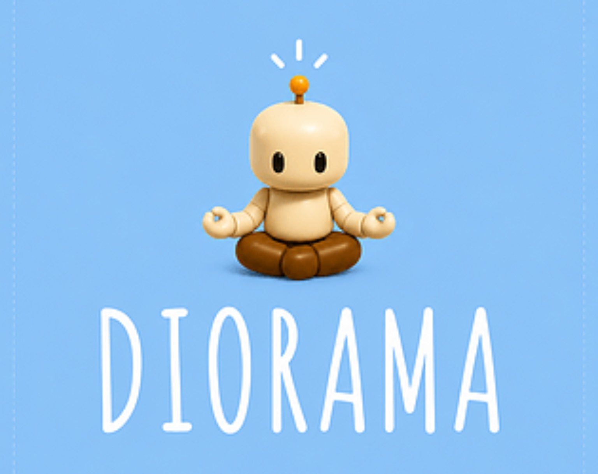
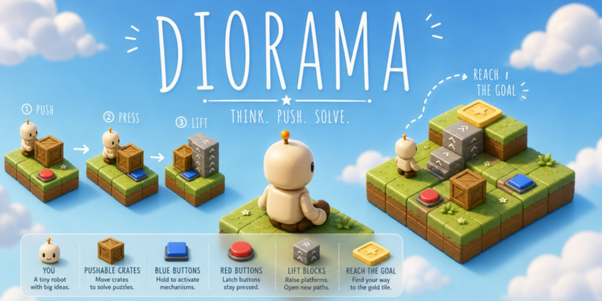
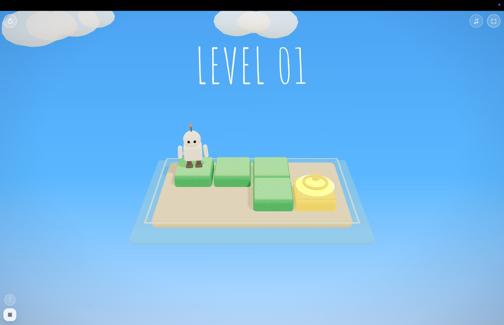
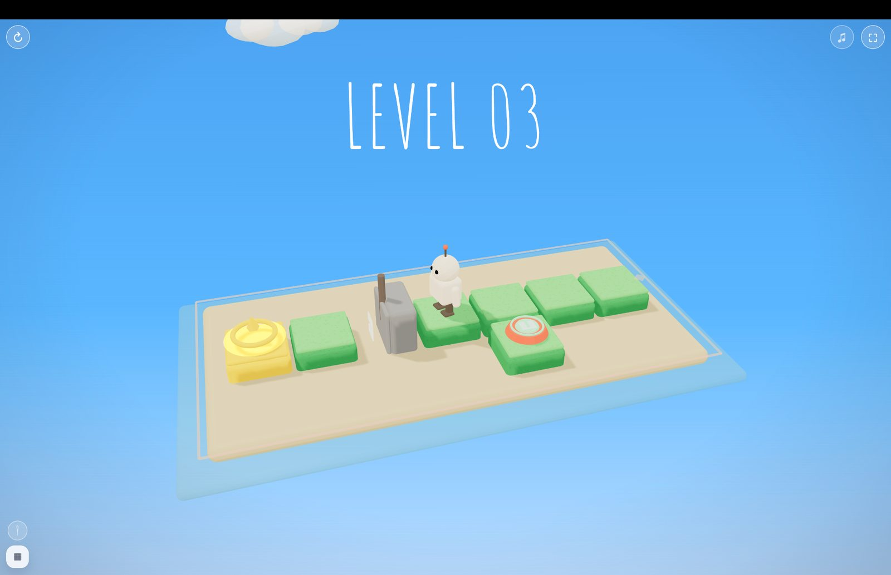
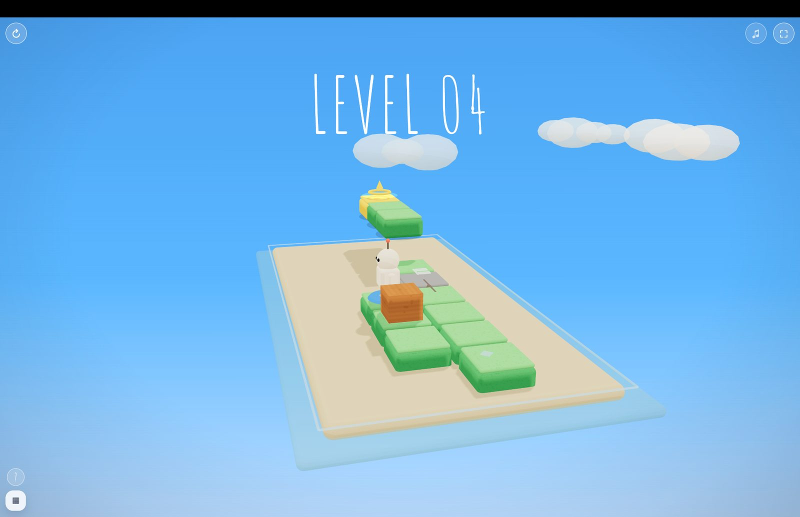
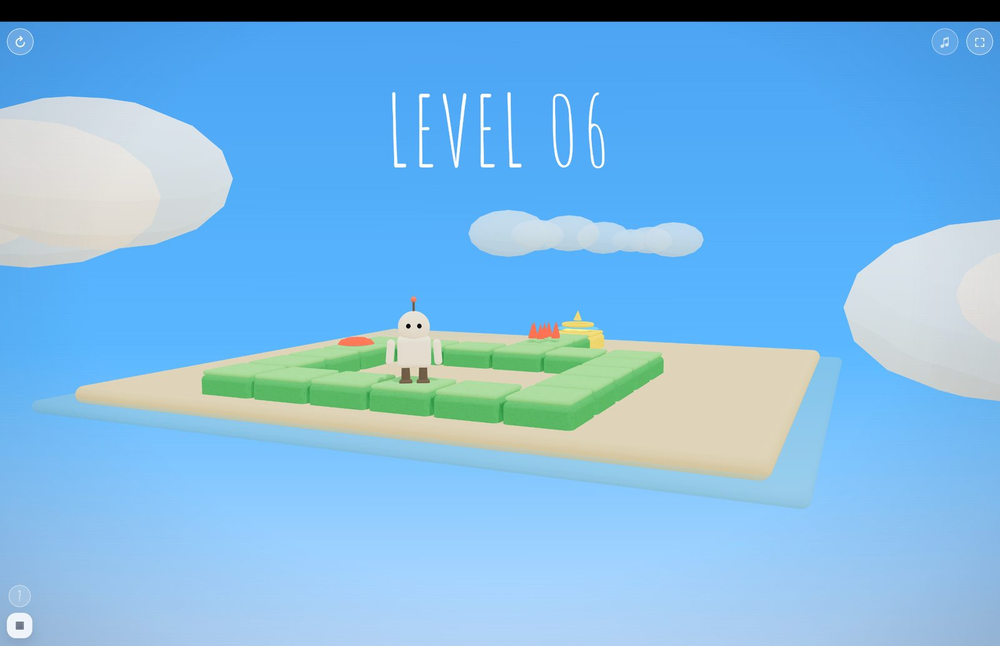
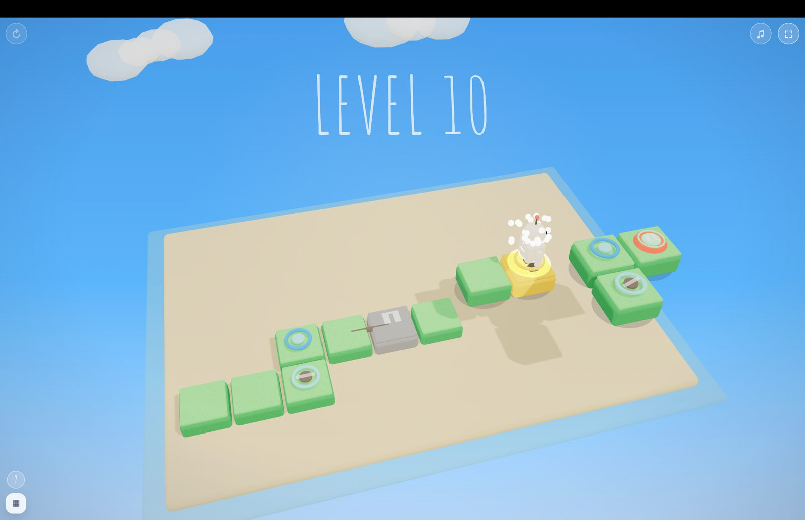

<p align="left"></p>

# DIORAMA

**Languages:** English · [简体中文](docs/i18n/README.zh-CN.md) · [日本語](docs/i18n/README.ja.md) · [한국어](docs/i18n/README.ko.md) · [Español](docs/i18n/README.es.md) · [Português (Brasil)](docs/i18n/README.pt-BR.md) · [Deutsch](docs/i18n/README.de.md) · [Français](docs/i18n/README.fr.md) · [العربية](docs/i18n/README.ar.md) · [繁體中文](docs/i18n/README.zh-TW.md)

**A playable 3D mechanical puzzle game built around route planning, moving architecture, and interactive mechanisms.**

[**Play DIORAMA on itch.io**](https://joenasr.itch.io/diorama) · [**Play the browser deployment**](https://diorama-game.vercel.app)

Explore compact isometric structures, operate bridges, lifts, gates, and switches, and guide a robot through routes whose connectivity changes as the puzzle responds.

**Interested in the project?** Star the repository to bookmark its development. Developers can explore the game code and contribute improvements. Contribution guidelines, issue templates, a pull request checklist, and a structural level validator are available. See [CONTRIBUTING.md](CONTRIBUTING.md) before proposing a change.


## The ending cinematic

<p align="center">
  <a href="https://diorama-game.vercel.app/ending/" title="Watch the DIORAMA ending cinematic">
    
  </a>
</p>

<p align="center"><strong><a href="https://diorama-game.vercel.app/ending/">WATCH THE ENDING CINEMATIC</a></strong> · <strong><a href="https://diorama-game.vercel.app/invest/">EXPLORE DIORAMA 2 & SUPPORT ITS DEVELOPMENT</a></strong></p>

The 60-second ending is an interactive Three.js experience with its original camera choreography and soundtrack. GitHub READMEs cannot execute the scene inline, so the preview opens the hosted cinematic. **Spoiler:** this reveals the game's finale without completing Level 25. The DIORAMA 2 page introduces the sequel and its optional, non-equity supporter tiers.

## Gameplay screenshots

<p align="center">
  <a href="docs/screenshots/level-01.jpg"></a>
  <a href="docs/screenshots/level-03.jpg"></a>
  <a href="docs/screenshots/level-04.jpg"></a>
  <a href="docs/screenshots/level-06.jpg"></a>
  <a href="docs/screenshots/level-10.jpg"></a>
</p>

<sub>Existing gameplay captures, not newly captured for the 4 November release. Select a thumbnail to view the full image.</sub>

## Exploring and extending DIORAMA

The existing level data describes tile layouts, start and goal cells, hints, difficulty bands, and collections of puzzle mechanisms. These are useful starting points for studying how DIORAMA puzzles work.

**Possible areas for contributions** (reviewed through issues and pull requests):

- Design and test additional levels using existing mechanics.
- Propose new mechanisms and puzzle interactions.
- Identify unreachable tiles, invalid mechanism states, visual overlaps, or touch-control problems.
- Improve mobile input, accessibility, and documentation.

The current distribution keeps the level definitions and engine logic together in `index.html`. There is **not yet** a separate level-file format or automated solvability test suite. A [level-authoring reference](docs/LEVEL_AUTHORING.md) and a read-only [structural validator](scripts/validate-levels.cjs) are available. Please do not assume that adding a level is plug-and-play.

After verified completion of Level 25, the current repository build launches a locally bundled 60-second ending cinematic. The ending preserves the recorded final win, pauses the underlying game renderer and background music, and provides clear routes to play again from Level 1 or view the DIORAMA 2 project page. See [ENDING_INTEGRATION_NOTES.md](ENDING_INTEGRATION_NOTES.md) for the integration boundary and validation record.

**Current Vercel production source (4 November 2026):** [`8f6128fdaa33ce900ac3b80b6a8f3cbeafc50c2e`](https://github.com/Joenasriani/diorama-game/commit/8f6128fdaa33ce900ac3b80b6a8f3cbeafc50c2e) on `main`, confirmed by Vercel as `READY` for [diorama-game.vercel.app](https://diorama-game.vercel.app/). This repository contains 25 levels, the integrated 60-second ending, and the [DIORAMA 2 support page](https://diorama-game.vercel.app/invest/). The in-game version label remains **v1.0**; deployment identifiers are not semantic game versions. The earlier owner-private Sites version **82** (Sites source `da14ef41b3bc54b0841c76a37173414d5b499215`) was previously matched to GitHub commit `956d01cef6423877bd114936f0fc3e974c503db9` by HTML Git blob hash. That is a historical verification record, **not the current Vercel source**. The itch.io distribution has not been compared with the current Vercel deployment.

## Current revision state

The 4 November 2026 release adds:

- a final-level cinematic with Pause, Sound, Skip ending, and Play Again controls;
- game-music watchdog isolation during the ending, with the game's music preference passed to the cinematic;
- a DIORAMA 2 coming-soon and backing page with a linked PayPal checkout; the three displayed contribution tiers describe proposed digital rewards, not investment equity;
- regular/bold font preloads and bounded readiness gates for startup lettering and the sequel page.

**Current DIORAMA 2 support page:** [Open the live page](https://diorama-game.vercel.app/invest/). The page reuses the original Three.js ending scene in a non-interactive embedded header and retains the castle/title artwork rather than replacing it with a CSS approximation. The header's investor-only presentation uses a mirrored left-half render, a solid muted-blue backdrop (`#5b777d`), a startup visibility gate and adjusted framing. The page currently displays **Early Explorer – $15**, **Founding Supporter – $35**, and **Patron – $100**, along with a prominent **Choose your backing tier** link to [PayPal checkout](https://www.paypal.com/ncp/payment/NYRC4Q6FTYXBJ). The link's presence is verified in repository HTML; successful checkout, reward fulfillment and payment-provider configuration have **not** been independently verified. Supporter backing is not an offer of equity or revenue participation. The castle's final centre-seam and lower-edge appearance still require visual confirmation on real devices.

The earlier 2 November gameplay revision includes:

- corrected and simplified routes for Levels 7, 8, 9, 12, 13, 14 and 15;
- restored Level 25 route integrity checks;
- visible route-stamp/gate unlock feedback;
- portal disappearance/reappearance timing with enlarged electrical strikes and transition audio;
- two-finger touch-camera tracking and pedestal movement while preserving pinch zoom;
- global reachable-upward-step assistance for small elevated mobile targets;
- route-aligned folding-bridge stems with structural validation for every bridge.

The detailed approval register is maintained in [`docs/UPGRADE_LEVELS_AND_FIXES.md`](docs/UPGRADE_LEVELS_AND_FIXES.md). Structural validation does not replace manual playthroughs; remaining level audits continue separately.

## Screenshots and gameplay footage

The [itch.io game page](https://joenasr.itch.io/diorama) provides the current public gameplay presentation. Five actual gameplay screenshots are available in the [gallery above](#gameplay-screenshots), along with a [social-preview asset](docs/screenshots/social-preview.png).

## GitHub participation

- **Star** if you find the project or its mechanical puzzle implementation useful.
- **Fork** through GitHub to explore the code, respecting the licensing restrictions that apply to downstream use.
- **Report reproducible bugs** with level number, device/browser, reproduction steps, expected outcome, and actual outcome.
- **Propose improvements** with clear gameplay rationale and enough details for review.

Contribution guidelines, issue/PR templates, [release procedures](docs/RELEASE_PROCESS.md), and structural CI checks have been added. A code of conduct and automated gameplay-solvability checks have not been verified as implemented. The browser game remains playable independently of these repository improvements.

## Repository scope

The current repository is a self-contained browser distribution:

```text
.
├── index.html
├── assets/
│   ├── fonts/
│   │   ├── AmaticSC-Bold.ttf
│   │   └── AmaticSC-Regular.ttf
│   └── music/
│       └── hitslab-game-gaming-music-295075.mp3
├── ending/
│   ├── index.html
│   └── audio/
│       └── ending score and sound effects
├── invest/
│   └── index.html
├── ENDING_INTEGRATION_NOTES.md
├── docs/
│   ├── LEVEL_AUTHORING.md
│   └── UPGRADE_LEVELS_AND_FIXES.md
├── scripts/
│   └── validate-levels.cjs
└── README.md
```

`index.html` contains the application UI, bundled Three.js runtime, level definitions, pathfinding, interaction logic, puzzle mechanisms, persistence, effects, and audio control code.

No package-manager install or application build step is required for the checked-in distribution.

## Runtime

| Area | Implementation |
| --- | --- |
| Rendering | Three.js r160, bundled into `index.html` |
| Camera | Perspective 3D camera with level-specific framing/orbit behavior |
| Game format | Single-page static HTML application |
| Levels | 25 |
| Level data | Embedded structured level definitions |
| Movement | Reachability-constrained click/tap navigation |
| Progress persistence | `localStorage` |
| SFX | Web Audio API synthesis |
| Background music | Local MP3 asset |
| Final-level ending | Local 60-second Three.js cinematic in `ending/` |
| Sequel information | Local responsive page in `invest/` |
| Fonts | Local Amatic SC font files |

## Puzzle model

Each level defines a start cell, goal cell, traversable tile coordinates, difficulty band, hint text, and zero or more mechanism collections.

Movement is not free-form. The robot moves through valid neighboring cells resolved against the current state of the level. Route availability can change as mechanisms are activated.

The runtime includes path and reachability helpers such as:

- `reachableNow()`
- `findPathToCell()`
- `reachablePathsFrom()`
- `bestReachablePathToward()`
- `requestMoveTo()`
- mechanism-specific route checks and automatic control resolution

Movement and interaction requests are therefore evaluated against the current logical puzzle state rather than raw visual proximity alone.

## Level progression

DIORAMA contains **25 levels** organized into progressively denser mechanic bands.

Early levels establish:

- basic tile movement;
- one-height stair traversal;
- folding bridges;
- crate and weighted-plate interaction;
- sliding path blocks;
- keys and locks.

Later levels combine mechanisms including:

- buttons and lift blocks;
- moving platforms;
- one-way paths;
- folding and gear bridges;
- reciprocating lift twins;
- transfer pads;
- bridge polarity switches;
- directional gates;
- route-stamp tiles and gates;
- magnetic crate-pull arrays;
- delayed lift triggers;
- step-block couplers;
- slide blocks;
- compound key/lock routes.

Level 25 is the full-system finale and combines multiple previously introduced systems in one route graph.

## Representative level structure

A level definition includes fields such as:

```text
name
puzzle
hint
start
goal
size
tiles
difficultyBand
buttons
liftBlocks
movers
danger
keys
keyLocks
oneWay
weightedPlates
foldingBridges
turnstiles
crates
slideBlocks
gearBridges
bridgePolaritySwitches
directionalGates
stepBlockCouplers
reciprocatingLiftTwins
transferPads
routeStampTiles
routeStampGates
magneticPullArrays
delayedLiftTriggers
underpassCells
```

Folding-bridge entries also define a cardinal `stemDir` so the visible hinge/stem points toward the bridge's real adjacent route anchor. The validator rejects missing, diagonal, or empty-space stem directions.

Unused mechanism arrays remain empty for levels that do not require them.

## Interaction and tap assistance

The input layer distinguishes ordinary pointer slop from a larger assistance radius, with separate mouse and touch values.

Current base values include:

```text
mouse tap slop:    22 px
touch tap slop:    46 px
mouse assist:      76 px
touch assist:      168 px
```

Touch assistance receives an additional small-screen adjustment.

When a tap does not land cleanly on the intended traversable surface, the runtime can resolve an assisted target using reachable-path and mechanism-aware logic rather than moving to an arbitrary nearby tile.

Specialized assistance exists for high-tier and multi-branch situations where projected surfaces can overlap visually.

Immediate reachable upward neighbors receive priority before broader scene hit-testing on small touch screens. This enlarges the practical target without allowing tier jumps, lock bypasses, or movement outside the live route graph.

Reachable helper meshes are used as interaction proxies but are intentionally rendered invisible in the current build.

## Moving geometry constraints

The implementation explicitly treats dynamic puzzle blocks as logical traversal surfaces rather than decorative animation.

Current movement rules include:

- moving/sliding bricks must not merge into fixed puzzle geometry;
- lift and moving-block logical cells are refreshed as mechanisms change state;
- traversal onto moving elements is validated before committing movement;
- stair transitions use bounded height changes;
- moving platforms and lifts participate in the same route-resolution system as fixed cells.

## Camera and presentation

The game uses a perspective camera with level-specific framing logic.

The runtime contains:

- level camera bounds;
- responsive camera-distance calculation;
- responsive pitch/target calculation;
- camera-start definitions;
- camera easing during level transitions;
- additional camera handling for specific reveal sequences;
- one-finger orbit control;
- two-finger horizontal tracking and vertical pedestal movement on touch screens;
- pinch-distance zoom that remains independent of two-finger camera translation;
- fullscreen support.

Camera rotation is part of inspection and navigation, while movement remains constrained by puzzle connectivity.

## Save data

Progress is stored in browser `localStorage`.

The current save structure tracks:

- highest unlocked level;
- last active level;
- best move counts by level.

The runtime also includes migration handling for an older save format.

If browser storage is unavailable or denied, the game continues without persistent progress.

A reset-progress control removes saved state and returns progression to Level 1.

## Audio

Background music is loaded from:

```text
assets/music/hitslab-game-gaming-music-295075.mp3
```

The runtime includes music preload/recovery handling for interrupted or stalled playback.

Interaction and feedback sounds are generated through the Web Audio API using synthesized tones.

Audio starts only after browser-permitted user interaction.

## Built-in UI utilities

The current build includes:

- level-select interface;
- mechanic legend/help interface;
- fullscreen toggle;
- music toggle;
- valid/invalid tap feedback;
- level-transition overlays;
- startup loading state;
- progress reset;
- move/best-move tracking.

## Controls

- Click/tap a reachable tile to move; click/tap mechanisms to interact.
- Drag with one finger to orbit; use two fingers to track/pedestal and pinch to zoom.
- Use the on-screen level selector, help, music and fullscreen controls.
- During the ending, Pause/Play and Sound control playback; Skip ending reveals the final actions. Play Again returns to Level 1 while retaining completion records.

## Running locally

No build step is required.

Serve the repository through HTTP:

```bash
python3 -m http.server 8080
```

Then open:

```text
http://localhost:8080/
```

Using an HTTP server is preferred over opening the page directly with `file://`, especially for local asset loading and browser security behavior.

## Deploying

Publish the repository's `index.html`, `assets/`, `ending/` and `invest/` together on a static HTTP(S) host, preserving their relative paths. No dependency installation or build command is required. Uploading only `index.html` omits required fonts, audio and ending pages.

Run `node scripts/validate-levels.cjs` before publication, then follow [the release checklist](docs/RELEASE_PROCESS.md). The existing GitHub workflow validates level structure; it does not deploy. Verify the actual hosted files against the release commit before claiming parity.

## Technical characteristics

- Static deployment: no backend is required.
- Runtime and Three.js engine code are bundled into the main HTML file.
- Core game assets are stored locally in the repository.
- Level definitions are embedded in the runtime rather than stored as separate JSON files.
- Game progression is client-side only.
- Save data is browser-local and is not synchronized across devices.
- The large single-file distribution favors direct deployment over modular source-level maintenance.

## Verification boundary

The repository demonstrates implemented pathfinding, mechanism state transitions, persistence, responsive input assistance, and 25 level definitions.

For the earlier 4 November integration release, syntax, focused audio/control/font checks and level structure passed. The coming-soon page rendered in the test browser, but gameplay and cinematic testing in that environment was blocked by a WebGL-context creation failure. Later investor-header commits have been published to Vercel and their production commit IDs verified. That **does not establish** real-device visual correctness: header flicker, mirrored-centre seam, lower-edge clearance, cold-load font transitions and real-device audio must be checked in the browser. No complete 25-level playthrough or end-to-end PayPal payment test is claimed here.

Those implementation facts do not by themselves establish exhaustive cross-browser compatibility, accessibility conformance, performance targets, or device-store certification.

## License and third-party assets

DIORAMA currently includes two Amatic SC font files and an MP3 named for HitsLab's *Game Gaming Music*. External source records identify Amatic SC as licensed under the SIL Open Font License 1.1 and the HitsLab track as distributed on Pixabay under the Pixabay Content License. These are **different licenses** and are not covered by the original-code MIT license.

- **Amatic SC:** the font family is offered under OFL-1.1. The exact checked-in binaries have not been matched to an upstream release; retain the applicable notices when redistributing.
- **HitsLab music:** the Pixabay Content License permits the track's use within creative projects such as DIORAMA, subject to its terms; the game credits **Music HitLabs**. The track is not MIT-licensed. Separate redistribution of the original MP3 from the public source repository remains a distinct rights question, as explained in the [third-party notices](THIRD_PARTY_LICENSES.md).
- **Bundled Three.js runtime:** the checked-in `index.html` was inspected via the Git blob API and includes a bundled notice identifying Three.js authors and SPDX-License-Identifier: MIT. The notice should remain intact.
- **Original game code:** MIT, copyright 2026 Joe Nasr, as recorded in `LICENSE`. Artwork, branding and third-party asset boundaries remain documented separately.
- **Ending music:** [Hero Heroic Patriotic by NastelBom](https://pixabay.com/music/main-title-hero-heroic-patriotic-436876/), via Pixabay, adapted into `ending/audio/hero-score-bed.mp3`. The track is offered under the Pixabay Content License, not MIT. Other ending effects retain separate provenance checks; see `THIRD_PARTY_LICENSES.md`.

The original-code MIT license is provided in [`LICENSE`](LICENSE). The bundled materials remain subject to separate terms and unresolved provenance or redistribution checks documented in [`THIRD_PARTY_LICENSES.md`](THIRD_PARTY_LICENSES.md).

Sources: [Amatic SC upstream metadata](https://github.com/google/fonts/blob/main/ofl/amaticsc/METADATA.pb) · [Amatic SC license](https://github.com/googlefonts/AmaticSC/blob/main/OFL.txt) · [HitsLab track](https://pixabay.com/music/happy-childrens-tunes-game-gaming-music-295075/).
