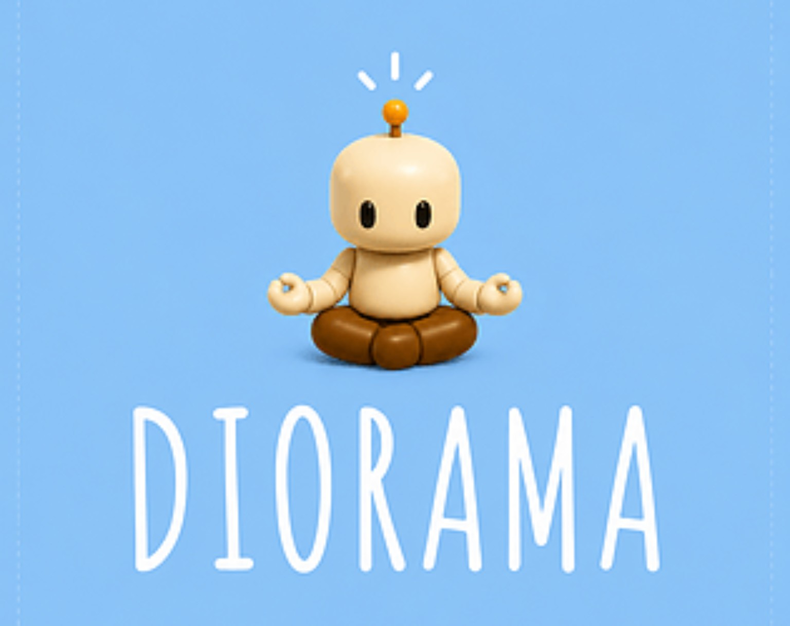
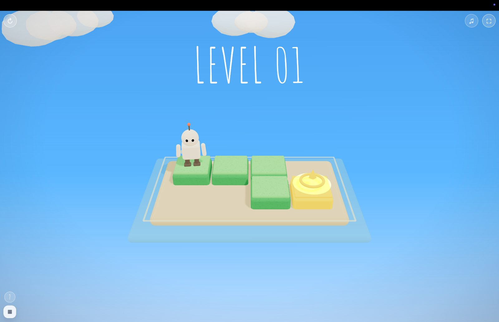
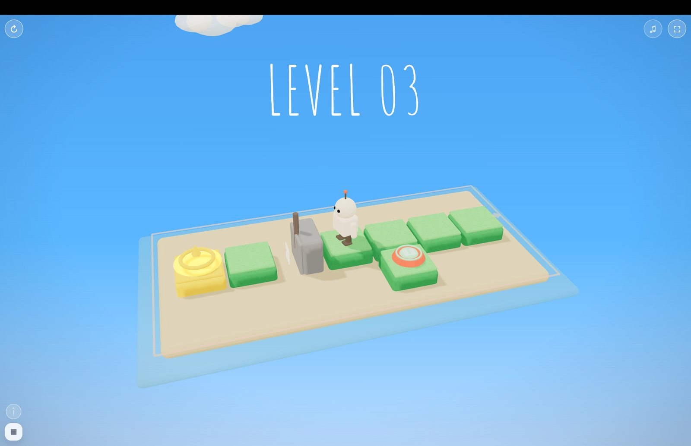
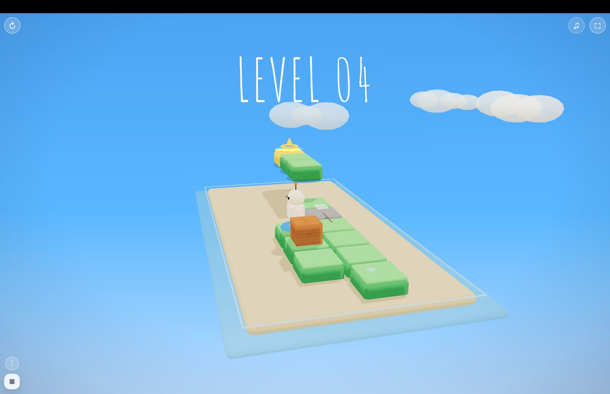
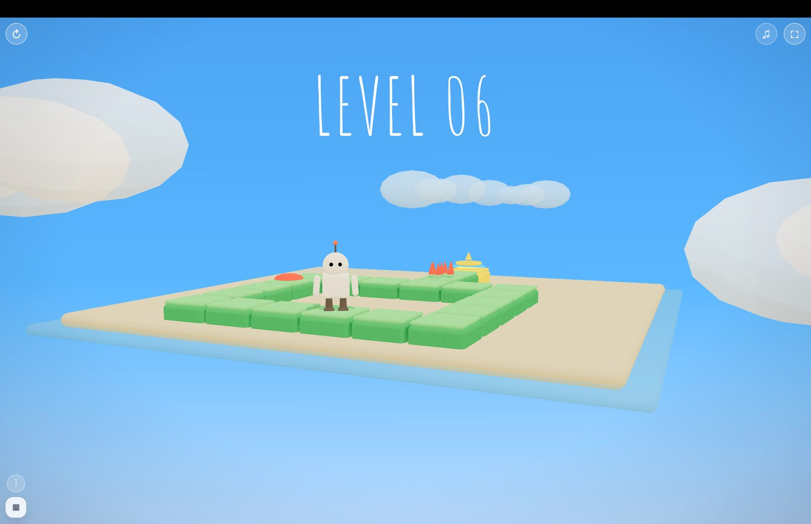
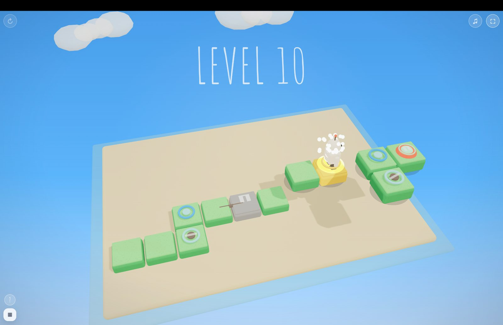

<p align="left"></p>

# DIORAMA

**Languages:** English · [简体中文](docs/i18n/README.zh-CN.md) · [日本語](docs/i18n/README.ja.md) · [한국어](docs/i18n/README.ko.md) · [Español](docs/i18n/README.es.md) · [Português (Brasil)](docs/i18n/README.pt-BR.md) · [Deutsch](docs/i18n/README.de.md) · [Français](docs/i18n/README.fr.md) · [العربية](docs/i18n/README.ar.md) · [繁體中文](docs/i18n/README.zh-TW.md)

**A playable 3D mechanical puzzle game built around route planning, moving architecture, and interactive mechanisms.**

[**Play DIORAMA on itch.io**](https://joenasr.itch.io/diorama) · [**Play the browser deployment**](https://diorama-game.vercel.app)

Explore compact isometric structures, operate bridges, lifts, gates, and switches, and guide a robot through routes whose connectivity changes as the puzzle responds.

**Interested in the project?** Star the repository to bookmark its development. Developers can inspect and extend the MIT-licensed original game code, subject to the separate rights applying to bundled third-party assets. Level submissions and external changes do not yet have a documented acceptance workflow; contributor tooling is proposed for a later phase.

> **Licensing:** Original code and documentation licensed by the copyright holder are provided under the [MIT License](LICENSE). This does **not** relicense the bundled fonts, Three.js runtime, music, or other third-party materials. See [third-party notices](THIRD_PARTY_LICENSES.md); music redistribution and asset provenance require separate review before redistributing a complete game package.


## Gameplay screenshots

<p align="center">
  <a href="docs/screenshots/level-01.jpg"></a>
  <a href="docs/screenshots/level-03.jpg"></a>
  <a href="docs/screenshots/level-04.jpg"></a>
  <a href="docs/screenshots/level-06.jpg"></a>
  <a href="docs/screenshots/level-10.jpg"></a>
</p>

<sub>Actual browser-game captures. Select a thumbnail to view the full image.</sub>

## Exploring and extending DIORAMA

The existing level data describes tile layouts, start and goal cells, hints, difficulty bands, and collections of puzzle mechanisms. These are useful starting points for studying how DIORAMA puzzles work.

**Possible areas for future contributions** (not yet a promise of an accepted PR workflow):

- Design and test additional levels using existing mechanics.
- Propose new mechanisms and puzzle interactions.
- Identify unreachable tiles, invalid mechanism states, visual overlaps, or touch-control problems.
- Improve mobile input, accessibility, and documentation.

The current distribution keeps the level definitions and engine logic together in `index.html`. There is **not yet** a separate level-file format, published level-authoring template, or verified automated solvability test suite. Please do not assume that adding a level is plug-and-play.

**Version distinction (verified 10 October 2026):** The repository's `main` branch `index.html` contains **25** named level definitions, numbered 01 through 25. The [itch.io game page](https://joenasr.itch.io/diorama) describes a **50-level** current version (page updated 4 October 2026). This repository therefore does **not** document the same advertised level count as the itch.io release. The version hosted on Vercel was not independently verified. Do not submit changes under the assumption that this repository represents the latest public game build.

## Screenshots and gameplay footage

The [itch.io game page](https://joenasr.itch.io/diorama) provides the current public gameplay presentation. A verified gameplay screenshot or animation has not yet been committed to this repository; any future preview should be captured from an actual build rather than generated or reconstructed.

## GitHub participation

- **Star** if you find the project or its mechanical puzzle implementation useful.
- **Fork** through GitHub to explore the code, respecting the licensing restrictions that apply to downstream use.
- **Report reproducible bugs** with level number, device/browser, reproduction steps, expected outcome, and actual outcome.
- **Propose improvements** with clear gameplay rationale and enough details for review.

Formal contribution, code-of-conduct, issue template, and release workflows are planned but are not represented here as already implemented. The browser game remains playable independently of these repository improvements.

## Licensing and third-party assets

DIORAMA currently includes two Amatic SC font files and an MP3 named for HitsLab's *Game Gaming Music*. External source records identify Amatic SC as licensed under the SIL Open Font License 1.1 and the HitsLab track as distributed on Pixabay under the Pixabay Content License. These are **different licenses** and should not be treated as part of a future game-code license.

- **Amatic SC:** the font family is offered under OFL-1.1. The exact checked-in binaries have not been matched to an upstream release; retain the applicable notices when redistributing.
- **HitsLab music:** the identifiable original track is listed under Pixabay's Content License. Its terms require separate review for redistributing a game source package that includes the MP3; a license for the game code does not automatically grant additional music rights.
- **Bundled Three.js runtime:** the checked-in `index.html` was inspected via the Git blob API and includes a bundled notice identifying Three.js authors and SPDX-License-Identifier: MIT. The notice should remain intact.
- **Original game code and artwork:** permission to publish and license all parts of the project has not been established by repository visibility alone.

The original-code MIT license is provided in [`LICENSE`](LICENSE). The bundled materials remain subject to separate terms and unresolved provenance or redistribution checks documented in [`THIRD_PARTY_LICENSES.md`](THIRD_PARTY_LICENSES.md).

Sources: [Amatic SC upstream metadata](https://github.com/google/fonts/blob/main/ofl/amaticsc/METADATA.pb) · [Amatic SC license](https://github.com/googlefonts/AmaticSC/blob/main/OFL.txt) · [HitsLab track](https://pixabay.com/music/happy-childrens-tunes-game-gaming-music-295075/).

## Repository scope

The current repository is a self-contained browser distribution:

```text
.
├── index.html
├── assets/
│   ├── fonts/
│   │   ├── AmaticSC-Bold.ttf
│   │   └── AmaticSC-Regular.ttf
│   └── music/
│       └── hitslab-game-gaming-music-295075.mp3
└── README.md
```

`index.html` contains the application UI, bundled Three.js runtime, level definitions, pathfinding, interaction logic, puzzle mechanisms, persistence, effects, and audio control code.

No package-manager install or application build step is required for the checked-in distribution.

## Runtime

| Area | Implementation |
| --- | --- |
| Rendering | Three.js r160, bundled into `index.html` |
| Camera | Perspective 3D camera with level-specific framing/orbit behavior |
| Game format | Single-page static HTML application |
| Levels | 25 |
| Level data | Embedded structured level definitions |
| Movement | Reachability-constrained click/tap navigation |
| Progress persistence | `localStorage` |
| SFX | Web Audio API synthesis |
| Background music | Local MP3 asset |
| Fonts | Local Amatic SC font files |

## Puzzle model

Each level defines a start cell, goal cell, traversable tile coordinates, difficulty band, hint text, and zero or more mechanism collections.

Movement is not free-form. The robot moves through valid neighboring cells resolved against the current state of the level. Route availability can change as mechanisms are activated.

The runtime includes path and reachability helpers such as:

- `reachableNow()`
- `findPathToCell()`
- `reachablePathsFrom()`
- `bestReachablePathToward()`
- `requestMoveTo()`
- mechanism-specific route checks and automatic control resolution

Movement and interaction requests are therefore evaluated against the current logical puzzle state rather than raw visual proximity alone.

## Level progression

DIORAMA contains **25 levels** organized into progressively denser mechanic bands.

Early levels establish:

- basic tile movement;
- one-height stair traversal;
- folding bridges;
- crate and weighted-plate interaction;
- sliding path blocks;
- keys and locks.

Later levels combine mechanisms including:

- buttons and lift blocks;
- moving platforms;
- one-way paths;
- folding and gear bridges;
- reciprocating lift twins;
- transfer pads;
- bridge polarity switches;
- directional gates;
- route-stamp tiles and gates;
- magnetic crate-pull arrays;
- delayed lift triggers;
- step-block couplers;
- slide blocks;
- compound key/lock routes.

Level 25 is the full-system finale and combines multiple previously introduced systems in one route graph.

## Representative level structure

A level definition includes fields such as:

```text
name
puzzle
hint
start
goal
size
tiles
difficultyBand
buttons
liftBlocks
movers
danger
keys
keyLocks
oneWay
weightedPlates
foldingBridges
turnstiles
crates
slideBlocks
gearBridges
bridgePolaritySwitches
directionalGates
stepBlockCouplers
reciprocatingLiftTwins
transferPads
routeStampTiles
routeStampGates
magneticPullArrays
delayedLiftTriggers
underpassCells
```

Unused mechanism arrays remain empty for levels that do not require them.

## Interaction and tap assistance

The input layer distinguishes ordinary pointer slop from a larger assistance radius, with separate mouse and touch values.

Current base values include:

```text
mouse tap slop:    22 px
touch tap slop:    46 px
mouse assist:      76 px
touch assist:      168 px
```

Touch assistance receives an additional small-screen adjustment.

When a tap does not land cleanly on the intended traversable surface, the runtime can resolve an assisted target using reachable-path and mechanism-aware logic rather than moving to an arbitrary nearby tile.

Specialized assistance exists for high-tier and multi-branch situations where projected surfaces can overlap visually.

Reachable helper meshes are used as interaction proxies but are intentionally rendered invisible in the current build.

## Moving geometry constraints

The implementation explicitly treats dynamic puzzle blocks as logical traversal surfaces rather than decorative animation.

Current movement rules include:

- moving/sliding bricks must not merge into fixed puzzle geometry;
- lift and moving-block logical cells are refreshed as mechanisms change state;
- traversal onto moving elements is validated before committing movement;
- stair transitions use bounded height changes;
- moving platforms and lifts participate in the same route-resolution system as fixed cells.

## Camera and presentation

The game uses a perspective camera with level-specific framing logic.

The runtime contains:

- level camera bounds;
- responsive camera-distance calculation;
- responsive pitch/target calculation;
- camera-start definitions;
- camera easing during level transitions;
- additional camera handling for specific reveal sequences;
- fullscreen support.

Camera rotation is part of inspection and navigation, while movement remains constrained by puzzle connectivity.

## Save data

Progress is stored in browser `localStorage`.

The current save structure tracks:

- highest unlocked level;
- last active level;
- best move counts by level.

The runtime also includes migration handling for an older save format.

If browser storage is unavailable or denied, the game continues without persistent progress.

A reset-progress control removes saved state and returns progression to Level 1.

## Audio

Background music is loaded from:

```text
assets/music/hitslab-game-gaming-music-295075.mp3
```

The runtime includes music preload/recovery handling for interrupted or stalled playback.

Interaction and feedback sounds are generated through the Web Audio API using synthesized tones.

Audio starts only after browser-permitted user interaction.

## Built-in UI utilities

The current build includes:

- level-select interface;
- mechanic legend/help interface;
- fullscreen toggle;
- music toggle;
- valid/invalid tap feedback;
- level-transition overlays;
- startup loading state;
- progress reset;
- move/best-move tracking.

## Running locally

No build step is required.

Serve the repository through HTTP:

```bash
python3 -m http.server 8080
```

Then open:

```text
http://localhost:8080/
```

Using an HTTP server is preferred over opening the page directly with `file://`, especially for local asset loading and browser security behavior.

## Technical characteristics

- Static deployment: no backend is required.
- Runtime and Three.js engine code are bundled into the main HTML file.
- Core game assets are stored locally in the repository.
- Level definitions are embedded in the runtime rather than stored as separate JSON files.
- Game progression is client-side only.
- Save data is browser-local and is not synchronized across devices.
- The large single-file distribution favors direct deployment over modular source-level maintenance.

## Verification boundary

The repository demonstrates implemented pathfinding, mechanism state transitions, persistence, responsive input assistance, and 25 level definitions.

Those implementation facts do not by themselves establish exhaustive cross-browser compatibility, accessibility conformance, performance targets, or device-store certification.
